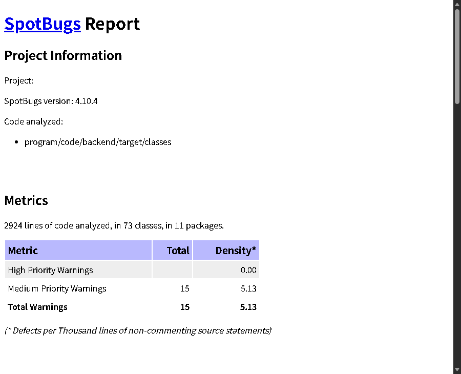

# 实验4 静态分析实验报告

课程：软件测试与质量保证    小组：第22组

测试对象：Keyboard MES后端    实验日期：2026年10月11日

## 1 实验目的与测试范围

本次使用SpotBugs和Alibaba Java Coding Guidelines检查后端代码，核查告警，并在相同范围复查。阿里规约检查覆盖72个Java源文件，结果为0项告警；SpotBugs分析73个编译类，发现15项告警。逐项核查后，13项判为当前框架场景下的误报，2项作为共享组件的设计风险保留，本轮未确认需要修改的源码缺陷。

分析范围为后端正式代码，不包含单元测试、前端、小程序或依赖库本身。现有FindBugs分析及此前规约修正结果用于追溯，与本次结果分开统计。

## 2 工具与扫描结果

SpotBugs使用官方4.10.4发行包，由JDK 17直接运行。后端通过Maven 3.9.9重新编译，清除旧类残留后得到73个类。扫描启用最大分析强度并报告所有优先级，提供项目实际依赖作为辅助类路径。初次扫描与复查均无分析错误和缺失类，没有修改工具或添加告警排除规则。

Alibaba Java Coding Guidelines使用阿里官方P3C PMD规则2.1.1，配合PMD 6.55.0解析Java 17源码，启用异常、注释、命名、集合、并发等十组规则。本次使用官方PMD实现，结果不代表IDE插件的附加检查或整部开发手册均已覆盖。消息资源仅补充XML格式声明，规则实现保持原样；扫描日志仍有DFA迭代提示，XML未记录处理错误。

| 工具 | 分析范围 | 初次告警 | 复查告警 |
| --- | --- | --- | --- |
| SpotBugs 4.10.4 | 73个编译类 | 15 | 15 |
| Alibaba Java Coding Guidelines | 72个源文件 | 0 | 0 |

告警数量与人工确认的缺陷数量分别记录。复查的15项仍是原有共享依赖告警；本轮保留源码和设计，不将其写成已经消除的缺陷。

图1 SpotBugs原生HTML报告中的版本、分析范围和告警统计

## 3 SpotBugs告警核查

15项告警均为EI_EXPOSE_REP2，即构造器保存外部可变对象引用。判定时结合依赖来源、字段访问范围、对象用途及配置修改位置，而非仅依据告警名称。结果如下。

| 位置 | 数量 | 人工判断 | 处理 |
| --- | --- | --- | --- |
| WebConfig的拦截器 | 1 | 框架场景误报 | 保留Spring注入与MVC注册 |
| ReportServiceImpl的Mapper | 6 | 框架场景误报 | 保留MyBatis代理 |
| TraceServiceImpl的Mapper | 5 | 框架场景误报 | 保留MyBatis代理 |
| MesShiroRealm的Mapper | 1 | 框架场景误报 | 保留Bean工厂注入 |
| AuthSessionService的共享组件 | 2 | 设计风险保留 | 维持初始化后配置稳定 |

前13项保存的是容器管理的协作对象，字段均为private final，未发现对外返回这些依赖的接口。Mapper本身是数据库代理，拦截器须注册到MVC；复制这些对象不符合现有框架协作方式。因此在当前项目使用场景下判为误报，不据此改变构造器注入。

另外2项涉及ObjectMapper和StringRedisTemplate。项目使用它们进行JSON转换和Redis数据访问，未发现运行期重新配置连接工厂、序列化器或JSON规则的调用，但对象共享与配置可变性客观存在。因此这2项不计为误报，保留当前设计风险：组件应在初始化时完成配置，开始处理请求后不得随意重配置。若后续增加动态配置功能，应重新评估并明确隔离方式。

误报率按“误报数除以已核查告警数”计算，为13/15=86.7%；设计风险为2项，确认需要修复的源码缺陷为0项。该比例仅针对本次EI_EXPOSE_REP2告警，不表示SpotBugs整体准确率。阿里规约未产生告警，误报率不适用。

## 4 历史修正与结果衔接

此前阿里规约扫描发现208项不符合，涉及接口Javadoc、作者标注、常量、集合容量和方法长度；完成修正后复查为0项。本次重新扫描仍为0项，说明当前代码在同一组已启用规则下保持原有结果。

2026年10月8日的FindBugs兼容分析覆盖73个类，发现8项告警，修正7项后复查剩1项编译器生成代码误报；同日96项既有单元测试全部通过。本次SpotBugs使用官方发行包直接分析Java 17，不沿用FindBugs工具适配。两种工具的检测实现与告警类型不同，不能把告警总数变化直接解释为代码质量退步。

本轮没有修改业务源码，没有重新执行单元测试或采集覆盖率。上述96项通过仅作为10月8日的历史回归结果。

## 5 实验总结

两种工具的扫描和人工核查均已完成，原始告警、逐项依据和同范围复查结果已留存。阿里规约检查未发现新的不符合项；SpotBugs提示的共享依赖风险结合框架设计作出区分，未通过批量复制对象或隐藏告警获取零告警结果。结论限于本次正式后端代码和已启用规则，不能据此认定整个系统没有缺陷。
